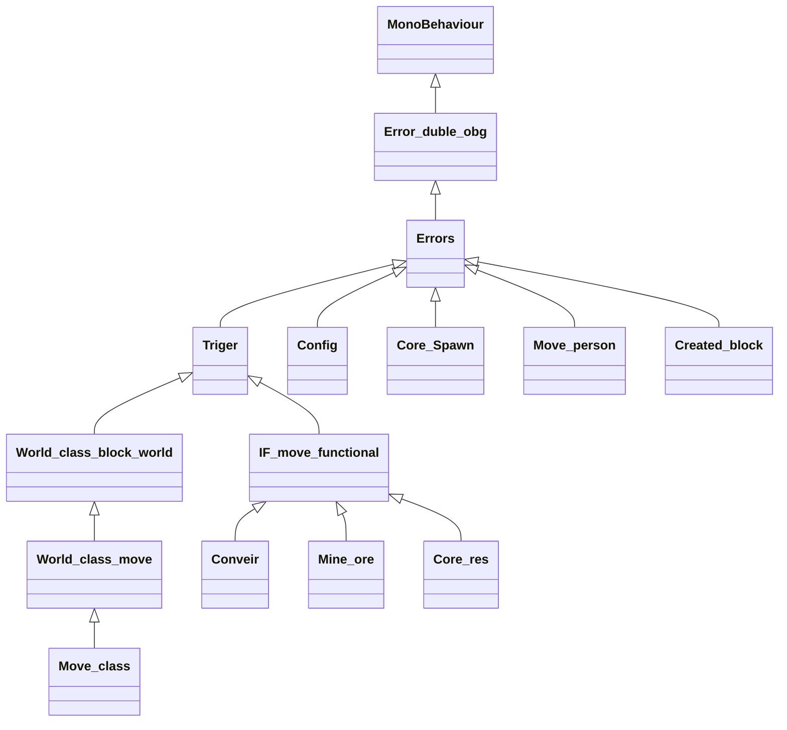
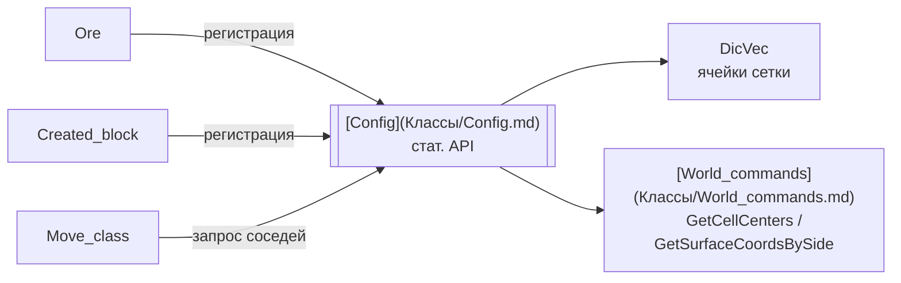
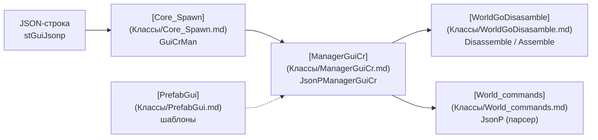

# MyPlay

## 🏗 Архитектура

### Иерархия базовых классов

Всё определяется в файле [World_commands](Классы/World_commands.md):



- **[Error_duble_obg](Классы/World_commands.md#Error_duble_obg)** — защита: если на объекте два компонента одной группы, второй уничтожается (OnValidate).
- **[Errors](Классы/World_commands.md#Errors)** — единая система проверок: `AwTestError` (Awake), `StTestError` (Start), `UpTestError` (Update). Ошибка = `World_command.Error` (лог + исключение).
- **[Triger](Классы/World_commands.md#Triger)** — подписчик событий: метод `Trigers(trig)` вызывается из [MainSystemTrigers](Классы/MainSystemTrigers.md).
- **[World_class_block_world](Классы/World_commands.md#World_class_block_world)** — база блока мира: `Date_two_list` (точка на грани), `CoordKey`.
- **[World_class_move](Классы/World_commands.md#World_class_move)** — абстракция «машина, через которую идёт руда»: `GetSize`, `test_napr_get`, `get_ore`, `get_napr`. Реализация — [Move_class](Классы/Move_class.md).
- **[IF_move_functional](Классы/World_commands.md#IF_move_functional)** — абстракция «логика машины»: `Up_Func_Ore`, `move_ore`, `get_ore_entity`. Реализации — [Conveir](Классы/Conveir.md), [Mine_ore](Классы/Mine_ore.md), [Core_res](Классы/Core_res.md).

### Поток данных (руды)

```mermaid
flowchart LR
    Ruda[[Рудный блок<br>[Ore](Классы/Ore.md)]] --> Mine[[[[Mine_ore](Классы/Mine_ore.md)<br>добывает]]
    Mine --> Conv[[[[Conveir](Классы/Conveir.md)<br>ведёт]]
    Conv --> Core[[[[Core_res](Классы/Core_res.md)<br>склад]]
    Core --> Player[Игрок<br>get_ore_entity]
    Player --> Crafter[Крафт<br>ResursesCraft]
```

1. [Ore](Классы/Ore.md) регистрирует рудный блок в [Config](Классы/Config.md) (тип `Mine_blick`).
2. [Mine_ore](Классы/Mine_ore.md) через `ORE_BLOCKS.GetOreInMy` (из [ORE_BLOCK](Классы/ORE_BLOCK.md)) находит руду рядом и добывает её в корутине.
3. [Conveir](Классы/Conveir.md) принимает руду с соседями (`get_ore`) и проталкивает по слотам res1→res2→res3.
4. [Core_res](Классы/Core_res.md) копит запас и выдаёт ресурс игроку (`get_ore_entity`, тег «Player»).

Соседство машин определяет [Move_class](Классы/Move_class.md) в событии `Update_Block` от [MainSystemTrigers](Классы/MainSystemTrigers.md): грани сравниваются через `World_command.GetSideFacing` (enum `Napr`: FRONT/BACK/TOP/BOTTOM/LEFT/RIGHT).

### Пространственный индекс сцены



- [Config](Классы/Config.md) владеет единственным статическим `DicVec obg_scene`.
- Типы объектов в индексе — enum `DicVec.Generated`: `Player_Block` (метка [Sattings_block_cr](Классы/Sattings_block_cr.md)), `Mine_blick` (метка [Ore](Классы/Ore.md)).
- Ключ ячейки — кастомный `Vector3Int` (смещение −0.5 к границам клеток).

### Динамический UI



UI собирается кодом из JSON: команды `add`/`del`/`comp`, свойства компонентов (Image, Text, Button, ScrollRect…), события через интерфейсы `JsonP.JsonPActionClass`.

### Постройка блоков игроком

1. [ControllerButton](Классы/ControllerButton.md) — Tab показывает/скрывает GUI, курсор.
2. UI-кнопка вызывает [ButtonCreateBlock](Классы/ButtonCreateBlock.md) → [Created_block](Классы/Created_block.md).
3. [Created_block](Классы/Created_block.md) создаёт «призрак» префаба, рейкастит камеру, показывает Act/notAct-рендер из [Config](Классы/Config.md), ЛКМ ставит блок и перезапускает триггеры.

### Вспомогательное

- [World_Types](Классы/World_Types.md) — `Dic_Rdic` (двунаправленный словарь), используется как удобный тип для пар.
- [BigStringLabel](Классы/BigStringLabel.md) — редакторное отображение `BigStringAttribute` (многострочные поля, например JSON GUI в [Core_Spawn](Классы/Core_Spawn.md)).

---

↩️ [Содержание](Содержание.md)
